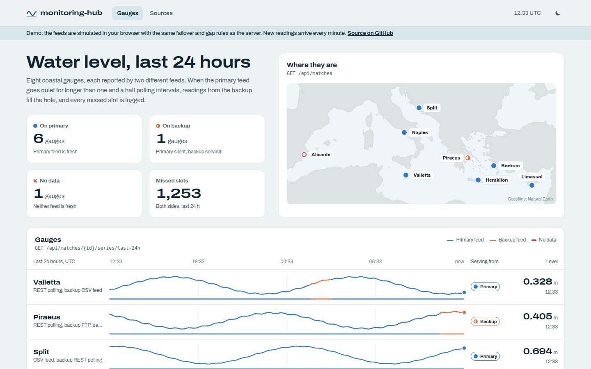
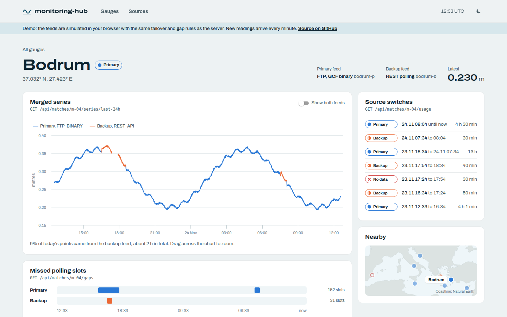
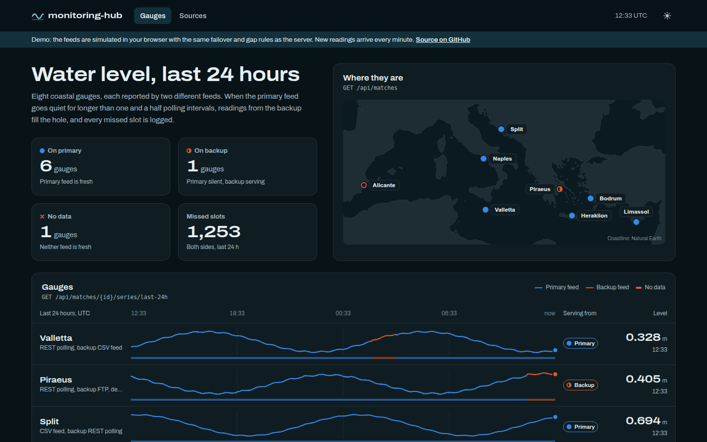

# monitoring-hub

A Spring Boot service that collects sensor readings from four kinds of feed (REST polling, a bulk CSV file, delimited files on FTP, and a binary format on FTP), stores them in one model, and serves them through one API. Version 0.2 adds failover between two feeds that report on the same gauge, a Redis cache in front of the chart endpoints, and a React dashboard.

**Live dashboard:** https://omercanbasboga.github.io/monitoring-hub/ (the feeds are simulated in the browser using the same failover and gap rules as the service)



## Why it exists

I built the original version of this at a university, for a sea-level monitoring system that pulled from several outside networks. That code, its data sources and its servers belong to the university and are not here. This repository is my own rewrite of the same design against a made-up set of gauges, so it can be read in public.

## What's in it

| Part | Where | What it does |
| --- | --- | --- |
| Connectors | `ingestion/` | One per feed type. Each is opt-in and does nothing until its URL or host is set. |
| Shared read/write layer | `service/StationDataService` | Upsert stations, skip readings already stored, fill gaps, downsample for charts. Written once, used by every connector. |
| Station matches | `match/` | Pair a primary and a backup station for one physical gauge and serve a merged series. |
| Cache | `cache/` | Read-through Redis cache with a warm-up job. |
| v2 history | `v2/` | Paged raw readings with limits on page size and range. |
| Demo feed | `demo/DemoFeed` | Eight gauges with a day of history and some outages, for running without any real feed. |
| Dashboard | `dashboard/` | React 18, MUI 5, Highcharts. Talks to the service or runs on its own simulation. |

## Failover

The same gauge often shows up in two networks. A match records which one is primary and which is backup. `FailoverMerger` reads both for the requested window and keeps the primary as it is. Where two primary readings are further apart than one and a half polling intervals, it fills the hole with the backup's readings from inside that hole. Holes at either end of the window count too, and if the primary sent nothing at all the backup serves the whole window. Nothing is stored; the merge happens on read.

A scheduled job (`MatchScanJob`, every minute over the last 15 minutes) does two things for each match. It writes every polling slot that either side missed to `match_gap`, and it records in `source_usage` when the match switched between primary, backup and nothing. The overlap between runs means a skipped run loses nothing, and slots already written are filtered before saving. Gap rows are never rewritten. If data arrives late, the slot was still empty when we looked.

Polling intervals come from the database and can be changed at runtime (`PUT /api/scheduler/intervals/{source}`), and the gap threshold follows them.



## Cache

`CacheService` wraps Redis with two rules. It fails open: if Redis is down or switched off, reads go to the database and writes are dropped, so the cache can make a request faster but never make it fail. Values are plain JSON read back with an explicit type, with no Jackson type ids, so moving a DTO class doesn't break entries already cached.

`CacheWarmup` rewrites every active station's last 24 hours before the key expires instead of evicting it, which avoids a burst of simultaneous misses. Range requests with free start and end times can't be cached under their own keys with any hope of a hit, but most of them fall inside the last day, so `CacheSlice` cuts them out of the warm 24-hour series in memory.

The cache is off by default (`CACHE_ENABLED=false`) so the service starts with nothing else installed.

## Running it

```bash
./mvnw spring-boot:run -Dspring-boot.run.profiles=demo
```

That starts on `:8082` with an in-memory H2 database and the demo feed. Swagger UI is at `http://localhost:8082/swagger-ui.html`. Without the `demo` profile the service starts empty and waits for connectors to be configured through environment variables (see `application.properties`).

With Postgres and Redis:

```bash
cp .env.example .env    # then set a password
docker compose up --build
```

The dashboard:

```bash
cd dashboard
npm install
VITE_API_URL=http://localhost:8082 npm run dev   # against the service
npm run dev                                      # on the built-in simulation
```

Tests: `./mvnw test`. Besides unit tests for the merger, the gap scanner, the cache slice, range checks, the GCF parser and the downsampler, `MatchApiTest` boots the app with the demo feed and checks the match API end to end.

## API

- `GET /api/unified/stations`: every station with its latest reading
- `GET /api/sources/{sourceType}/stations/{externalId}/readings/chart/last-24h`: gap-filled and downsampled
- `GET /api/matches`, `POST /api/matches`, `PUT /api/matches/{id}`: station matches (no delete, so history stays attached)
- `GET /api/matches/{id}/series/last-24h`: merged series, each point tagged `PRIMARY` or `SECONDARY`
- `GET /api/matches/{id}/gaps`, `GET /api/matches/{id}/usage`: missed slots and source switches
- `GET /api/v2/sources/{sourceType}/stations/{externalId}/readings?start=&end=&page=&size=`: paged history, newest first, at most 1000 rows a page and 366 days a range
- `GET /api/scheduler/intervals`, `PUT /api/scheduler/intervals/{source}?intervalMs=`



## Notes

- The binary connector reads GCF (Güralp Compressed Format). `GcfBinaryParser` decodes it from the byte layout and has a test that builds a block by hand.
- `ChartDownsampler` uses min-max bucketing so a single spike survives downsampling. [`minmax-lttb-downsampler`](https://github.com/Omercanbasboga/minmax-lttb-downsampler) is the same idea as a standalone library.
- The dashboard map is drawn from Natural Earth 1:50m land (public domain), clipped by `dashboard/scripts/build-map.mjs`. Gauge positions are real harbours; every reading is generated.
- Highcharts is free for personal and non-commercial use. Commercial use of the dashboard needs a Highcharts licence.
